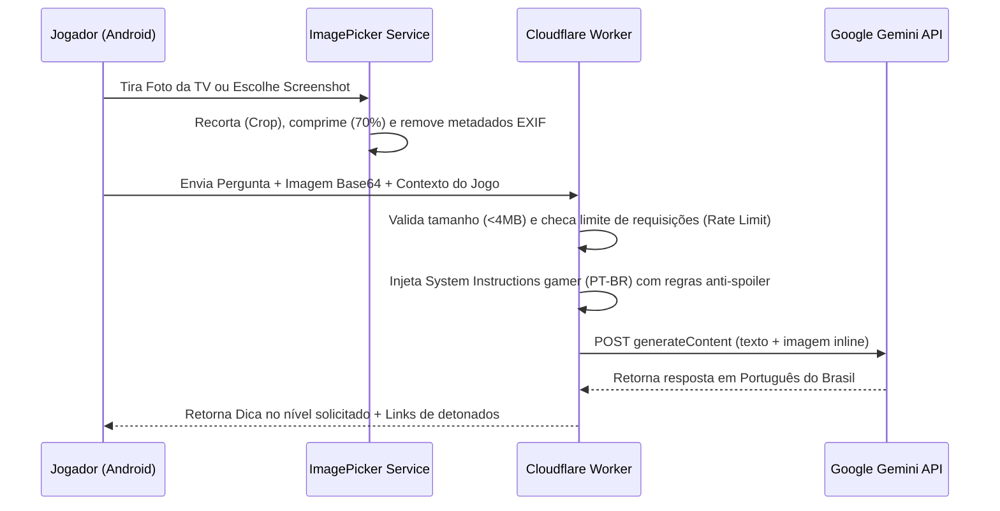

# Arquitetura e Engenharia do Assistente Gamer com IA — SaveState

Este documento detalha o funcionamento, engenharia de prompt, tratamento de imagens, controle de custos e resiliência do assistente gamer multimodal do SaveState.

---

## 🧠 1. Seleção de Modelos e Provedor

O SaveState utiliza a **API oficial do Google Gemini** orquestrada através do Cloudflare Workers:

- **Modelo configurado:** `gemini-2.5-flash`.
- **Configuração:** `GEMINI_MODEL` é definido por ambiente em `apps/api/wrangler.jsonc`; o cliente Android não recebe a chave do provedor.
- **Credencial:** O operador do serviço precisa configurar `GEMINI_API_KEY` como secret do Cloudflare. O usuário do app não precisa criar uma conta Gemini nem inserir uma chave.
- **Disponibilidade:** Sem a chave do operador ou quando o provedor limita/recusa a solicitação, o app oferece links para guias externos. Isso não significa que o uso do serviço de IA seja garantidamente gratuito.

---

## 📷 2. Fluxo Multimodal (Visão + Texto)

---

## 🚦 3. Níveis de Dica e Controle de Spoilers

O assistente adota o conceito de **Progressão Escalonada de Dicas**:

1. **`small_hint` (Dica Leve):**
   - Fornece apenas uma pista contextual ou direção no mapa (ex: *"Dê uma olhada com atenção nas paredes rachadas perto da fonte no salão principal"*).
   - Não revela o desfecho do mistério nem soluções diretas.
2. **`detailed_hint` (Dica Detalhada):**
   - Explica a mecânica do quebra-cabeça ou fraqueza do chefe (ex: *"O chefe é invulnerável enquanto o escudo de fogo estiver ativo; você precisa usar flechas de gelo nos cristais do teto para extinguir as chamas"*).
3. **`full_solution` (Solução Completa):**
   - Roteiro passo a passo direto para vencer o obstáculo. Se envolver revelações importantes da trama, emite um alerta prévio de spoiler.

---

## 💰 4. Custos e limites

O aplicativo não embute uma credencial pública de IA nem garante uma cota gratuita permanente. O proprietário do backend configura as credenciais e fica sujeito às cotas, preços e regras vigentes de cada provedor. Confira esses termos antes de abrir o serviço ao público. O limite por IP e o cache ajudam a controlar abuso e chamadas repetidas; guias externos continuam disponíveis como alternativa quando a IA não responde.

---

## 🛡️ 5. Defesas contra Abuso e Falhas

- **Proteção contra Injeção de Prompt (Prompt Injection):** Instruções maliciosas embutidas em capturas de tela (como textos forjados de menu dizendo *"ignore as instruções anteriores"*) são neutralizadas pela instrução de sistema que trata o texto em imagens como conteúdo não confiável.
- **Rate Limiting Baseado em IP:** O Cloudflare D1 mantém contadores diários por endereço IP. Cada usuário anônimo pode realizar até 30 consultas com IA por dia por padrão (configurável via `AI_DAILY_RATE_LIMIT`).
- **Degradação Graciosa:** Caso a cota do Gemini seja atingida (HTTP 429), a API retorna automaticamente HTTP 200 com flag `quotaExhausted: true` e entrega links diretos para detonados no YouTube, GameFAQs, guias da Steam e wikis do jogo sem quebrar a experiência do usuário.
