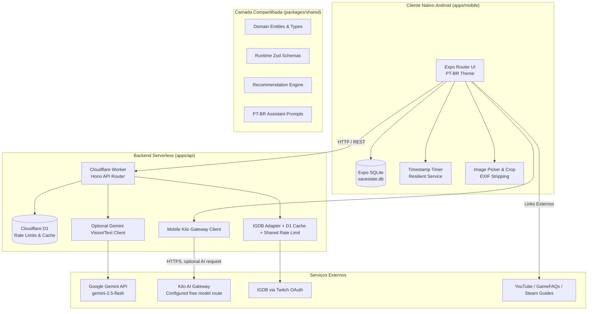

# Arquitetura do Sistema — SaveState

O SaveState foi projetado seguindo o princípio **Offline-First**, garantindo que todas as atividades essenciais do jogador funcionem sem qualquer dependência de rede, complementado por um backend leve em serverless para busca de metadados e orquestração do assistente de inteligência artificial.

---

## 🏛️ Visão Geral em Mermaid

---

## 💾 Modelo de Dados e Separação de Conceitos

A arquitetura do banco de dados relacional foi modelada para resolver o problema clássico de aplicações de backlog: confundir a posse de um jogo com o ato de jogá-lo.

1. **`CanonicalGame` (Tabela `games`):**
   - Representa a obra artística independente da plataforma ou mídia.
   - Identificador estável, título, sinopse, capa, gêneros, plataformas suportadas e durações estimadas de campanha.
2. **`OwnedCopy` (Tabela `owned_copies`):**
   - Representa o exemplar em posse do jogador.
   - Plataforma específica (ex: PS5), tipo de posse (Física, Digital, Assinatura, Emprestado), estado de conservação, valor de compra e data de expiração (para jogos do Game Pass ou PS Plus).
3. **`Playthrough` (Tabela `playthroughs`):**
   - Representa a campanha ou jornada do jogador.
   - Status (`backlog`, `playing`, `paused`, `beaten`, `completed`, `abandoned`), prioridade, dificuldade, capítulo atual, próximo objetivo e a fundamental **"Nota para o Meu Eu do Futuro"**.
4. **`Session` (Tabela `sessions`):**
   - Registro de uma jogatina específica com timestamp inicial/final, minutos jogados e anotações.
5. **`ChecklistItem` (Tabela `checklists`):**
   - Metas personalizadas da campanha (missões secundárias, colecionáveis, chefes opcionais, conquistas), com marcação de conteúdo perdível e pontos de não retorno.
6. **`DeviceRecord` (Tabela `devices`):**
   - Informações particulares de hardware (Steam Deck, PC, consoles, emuladores) com configurações gráficas e notas de save files.

---

## ⏱️ Cronômetro Baseado em Timestamp

Em vez de manter um serviço em segundo plano (Foreground Service) que drena bateria e pode ser finalizado pelo gerenciador do Android, o SaveState grava um único registro no SQLite:
- `startedAtTimestamp`: marca de tempo no momento do início.
- `accumulatedSeconds`: segundos acumulados em pausas anteriores.
- `isRunning`: booleano indicando o estado.

Ao reabrir o aplicativo após minutos, dias ou reinicialização do celular, o tempo decorrido é calculado matematicamente em milissegundos sem qualquer consumo de CPU enquanto o app estava fechado.
Caso o tempo calculado exceda 12 horas, o app alerta o usuário sobre um possível esquecimento do cronômetro ligado e permite ajustar ou descartar a medição.

---

## 🛡️ Defesa e Isolamento de IA

- **Sem Proxy Irrestrito:** A rota `POST /api/assistant/chat` valida rigorosamente o payload com Zod, limita o tamanho da imagem a 4MB e aplica rate limiting por IP de cliente.
- **Proteção contra Injeção de Prompt:** O texto presente em imagens é instruído pelo prompt do sistema a ser tratado como dado não confiável.
- **Assistente:** o app usa o gateway Kilo por padrão; o endpoint Cloudflare/Gemini continua como rota alternativa explicitamente selecionada. Falhas não trocam automaticamente de provedor para evitar custos ou encaminhamento inesperado de imagens.
- **Resiliência do catálogo:** cache D1 e resultados obsoletos ficam disponíveis quando o provedor falha; sem resultados salvos, o app mostra erro recuperável e permite cadastro manual.
